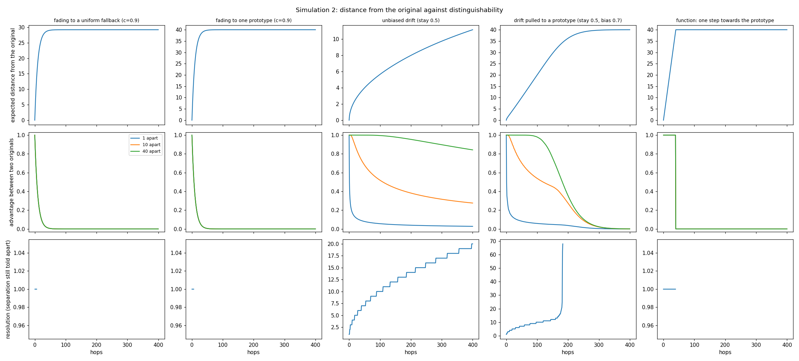
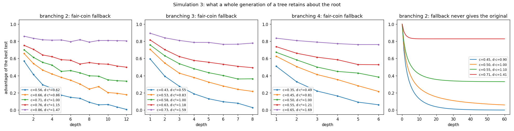

# Simulations of the retelling model

Six simulations around [`Complexity/Lossy.lean`](../Complexity/Lossy.lean) and
[`Complexity/Noisy.lean`](../Complexity/Noisy.lean). The theorems there are bounds. These
runs show where the bounds are tight, where they are silent, what happens in settings that
are not formalized (trees, many routes), and whether the experiments proposed for the book
could tell the models apart. None of them is evidence about how people retell things.

Run any of them with `python3 s1_tightness.py` and so on (numpy, scipy, matplotlib). Numbers
land in `out/*.json`, figures in `out/*.png`. Random seeds are fixed. Simulation 5 reads the
book's own text, so its numbers change when the book does.

Vocabulary: a *hop* is one retelling; the *advantage* between two originals is how much
better than chance the best test on the outcome tells which one was sent (1 is certainty,
0 is nothing); a hop's *one-hop constant* is its worst advantage over all pairs of inputs.

## What came out, in short

| | Question | Answer |
|---|---|---|
| 1 | How loose is the proved law "advantage after n hops ≤ product of one-hop constants"? | Exact for the fading hop. Silent for hops that change ideas only locally once the space of ideas is large: there the one-hop constant is 1, yet distinguishability does decay, slowly, at a rate set by the size of the idea space |
| 2 | Do distance from the original and distinguishability move together? | No. Forgetting makes distance level off while distinguishability collapses, equally for all pairs. Drift makes distance creep up while close originals are confused within a hop or two and distant ones stay apart for a long time |
| 3 | What does redundancy buy against depth? | For one receiver, the routes needed to hold the line grow like c^(−2n) or c^(−n) with depth n. On a tree, simulation is consistent with the threshold reported in the literature for the two-idea case (branching above 1/c²), without locating it; when the fallback can never pass for the original the threshold is branching above 1/c |
| 4 | Can the proposed experiments separate the models, and how big must they be? | Noisy people and one particular mix of fixed people give the same curve; rerunning the same chain separates them. A 30-chain caveat pilot sees a retention gap of 0.2 per hop, not one of 0.1 |
| 5 | What does the budget-against-tolerance curve look like for real text? | With a lexical distance the budget rises steadily across the usable range of tolerance, about one bit per 0.05. The book's claims need fewer balls than unstructured points, provably so at tolerance 0.2 and below |
| 6 | What does a language model do as reteller? | It cuts the text once at the first retelling, then erodes conditions slowly for two more hops and settles. It is noisy at the first pass, not a fixed function. Conditions survived about as well as the claim |

## 1. How loose is the product law? (`s1_tightness.py`)


True advantage for the worst pair of originals, computed exactly from matrix powers, against
`c^n` with `c` the one-hop constant, and against the asymptotic rate (second eigenvalue).

| hop | one-hop constant | second eigenvalue | true advantage at 10 hops | bound at 10 hops | hops until true advantage < 1/2 |
|---|---|---|---|---|---|
| fading, c = 0.9, 20 ideas | 0.90 | 0.90 | 0.349 | 0.349 | 7 |
| lazy cycle, 3 ideas, stay 0.9 | 0.90 | 0.854 | 0.211 | 0.349 | 6 |
| lazy cycle, 10 ideas | 1 | 0.983 | 0.997 | 1 | 55 |
| lazy cycle, 50 ideas | 1 | 0.9993 | 1.000 | 1 | more than 200 |
| drift on a line, 50 ideas, stay 0.8 | 1 | 0.9996 | 1.000 | 1 | more than 200 |
| random dense, 20 ideas | 0.68 | 0.21 | 0.000 | 0.022 | 2 |
| random sparse, 20 ideas | 1 | 0.66 | 0.053 | 1 | 5 |
| half fading (0.9), half drift, 50 ideas | 0.95 | 0.95 | 0.599 | 0.599 | 14 |

The bound was never exceeded. It is attained by the fading hop, and by the one mixture
tried here in which half the hop is a fade, because the fade sets the worst pair. It is far
from attained by a random dense hop, which also forgets in the library's sense. For hops
that only move ideas to neighbours, once the space is large enough that two ideas share no
neighbour (four or more on a cycle), the one-hop constant is 1 and the law says nothing;
what then governs loss is how long it takes to mix across the whole space of ideas, which
grows with that space. On three ideas the lazy cycle still contracts with 0.9
(`Noisy.lazyCycle_contracts`). The long-run rate is the second eigenvalue, which can be far
below the one-hop constant and is not what the theorem uses. This matches
`Noisy.lazyCycle_two_hops` and `Noisy.lazyFour_two_hops`.

## 2. Distance against distinguishability (`s2_distance.py`)



Ideas on a line of 101 points, original at 30.

| reteller | expected distance at hops 1, 10, 100, 400 | advantage against an original 1 / 10 / 40 places away, at 10 hops | smallest separation still told apart (advantage ≥ 1/2) at hops 1, 10, 100 |
|---|---|---|---|
| fading to a uniform fallback, c = 0.9 | 2.9, 19, 29, 29 | 0.35 / 0.35 / 0.35 | 1, none, none |
| fading to one prototype, c = 0.9 | 4, 26, 40, 40 | 0.35 / 0.35 / 0.35 | 1, none, none |
| unbiased drift, stay 0.5 | 0.5, 1.8, 5.6, 11 | 0.18 / 0.97 / 1.00 | 1, 4, 10 |
| drift pulled to a prototype | 0.5, 2.4, 20, 40 | 0.18 / 0.98 / 1.00 | 1, 3, 10 |
| function: one step towards the prototype | 1, 10, 40, 40 | 1 / 1 / 1 | 1, 1, none (all merged on arrival) |

Three signatures that an experiment could look for:

- **Forgetting**: how well two originals can be told apart does not depend on how different
  they were. Distance from the original levels off early.
- **Drift**: close originals are confused within a hop or two (advantage 0.5 after one hop
  for neighbours, 0.18 after ten), distant ones stay apart; the separation that survives
  grows like the square root of the depth. Distance from the original grows slowly and
  keeps growing.
- **A fixed function**: every pair is all or nothing at every depth
  (`Noisy.detHop_dichotomy`). In the one function tried here, a step towards a prototype,
  pairs merge as they arrive at it.

A claim with and without one of its conditions is a pair of *close* originals. So drift
alone predicts that whether a condition was there is the first thing a reader can no longer
tell, with no separate mechanism for "keys". (Unbiased drift adds a condition as often as it
removes one, so this is about telling the versions apart, not about conditions vanishing.)
That is a suggestion from the model, not a finding.

## 3. Trees and several routes (`s3_trees.py`)



**A whole generation of a tree**, every edge a fading hop on two ideas with a fair-coin
fallback. Advantage of the exact Bayes test on generation n (6,000 sampled trees per point,
standard error about 0.013), against one chain of the same depth:

| branching d, depth | d·c² = 0.5–0.6 | ≈ 0.85 | 1.0 | ≈ 1.2 | ≈ 1.5–1.7 | one chain, same depth and c |
|---|---|---|---|---|---|---|
| 2, depth 12 | 0.01 | 0.18 | 0.34 | 0.50 | 0.81 | 0.001 to 0.16 |
| 3, depth 8 | 0.03 | 0.22 | 0.36 | 0.49 | 0.78 | 0.001 to 0.08 |
| 4, depth 6 | 0.06 | 0.22 | 0.38 | 0.53 | 0.76 | 0.002 to 0.08 |

The rows at `d·c²` of 1.5 to 1.7 level off; the rows at 0.5 to 0.85 keep falling. At 1.0 and
at 1.2 the curves are still falling at the last depth simulated, so these runs are
consistent with a threshold at `d·c² = 1`, as reported in the literature for this two-idea,
fair-coin case, but they do not locate it. (The attribution is in the library's README and
is known to me only from summaries. None of this is machine-checked.) A plain majority vote
over the generation does almost as well as the exact test. What is retained is one bit,
which of two originals was sent, and only by pooling the whole generation: each single
member is still under `c^n`.

**When the fallback cannot imitate the original** (everything forgotten turns into
"something else"), one surviving copy proves which original was sent, and the advantage is
the survival probability of a branching process. Exact recursion: at `d·c = 0.9` it goes to
0, at `d·c = 1.1` it levels at 0.33 (d = 2), at `d·c = 1.41` at 0.83. The threshold is
`d·c = 1`, not `d·c² = 1`. For `c = 0.6` that is the difference between needing three
listeners per teller and needing two.

**k independent chains to one receiver**, each of n fading hops with c = 0.9, exact:

| depth | one route | two routes, fair-coin fallback | three routes, fair coin | two routes, fallback never gives the original | bound proved for two routes, `1 − (1 − a)²` | routes needed for advantage 1/2: fair coin / never |
|---|---|---|---|---|---|---|
| 5 | 0.590 | 0.590 | 0.783 | 0.832 | 0.832 | 1 / 1 |
| 10 | 0.349 | 0.349 | 0.502 | 0.576 | 0.576 | 3 / 2 |
| 20 | 0.122 | 0.122 | 0.182 | 0.228 | 0.228 | 31 / 6 |
| 30 | 0.042 | 0.042 | 0.064 | 0.083 | 0.083 | 253 / 17 |
| 40 | 0.015 | 0.015 | 0.022 | 0.029 | 0.029 | 2083 / 47 |

Two routes with a fair-coin fallback give exactly what one gives
(`Noisy.two_routes_no_gain_bool`), though a third route does help; the proved bound
(`Noisy.two_routes_le`) is exactly attained when the fallback never gives the original
(`Noisy.two_routes`). The number of routes needed to hold the line grows like `c^(−2n)` in
the first case and `c^(−n)` in the second. Either way, redundancy has to grow exponentially
with depth.

## 4. What the proposed experiments can separate (`s4_design.py`)


- **Noisy people against a mix of fixed people.** The mix is the one in
  `Noisy.fade_eq_mixture`: a share c of people who repeat faithfully, the rest people who
  always say their own thing. Over 40,000 chains each (c = 0.8, ten ideas), the share ending
  on the original differs by at most 0.008 at any depth, and both follow
  `c^n + (1 − c^n)·ν(x)` (`Noisy.prob_fade_self`): it falls to a floor, not to zero. Nothing
  here covers a crowd of retellers who each compress in a different way.
- **Rerunning the same chain of people on the same original** (depth 6, c = 0.8, ten
  ideas). Two reruns end the same in 16% of chains when everyone is noisy, 32%, 50%, 73%
  when a quarter, half, three quarters of people are fixed, and always when all are. So
  reruns can estimate how much of the randomness is in who the retellers are.
- **How many chains to see anything at depth n.** A power calculation, not a simulation:
  the smallest number of chains for which an exact one-sided binomial test at 5% detects,
  with 80% power, that receivers pick the original out of a two-way line-up more often than
  chance.

  | | depth 1 | 3 | 6 | 10 |
  |---|---|---|---|---|
  | c = 0.9 | 8 | 11 | 23 | 51 |
  | c = 0.7 | 13 | 53 | 448 | 7,758 |

- **The caveat-loss pilot** ([`content/experiments/caveat-loss-per-hop.md`](../../content/experiments/caveat-loss-per-hop.md),
  about 30 finding-chains, three conditions each, claims retained at 0.9 per hop). Power of
  a one-sided test at 2.5% to see that conditions are lost faster:

  | finding-chains | hops | conditions 0.8 | 0.7 | 0.6 |
  |---|---|---|---|---|
  | 10 | 2 / 3 | 0.13 / 0.19 | 0.40 / 0.57 | 0.74 / 0.86 |
  | 30 | 2 / 3 | 0.39 / 0.54 | 0.90 / 0.97 | 1.00 / 1.00 |
  | 100 | 2 / 3 | 0.91 / 0.98 | 1.00 / 1.00 | 1.00 / 1.00 |

  Loss concentrated at the first hop (0.6, then 0.85) is told from constant loss with
  power 0.98 at 30 chains, with a false-alarm rate of 5%.

  These powers assume every condition is lost independently. If conditions of one finding
  are lost together, the real power is lower.

## 5. Covering numbers of real text (`s5_covering.py`)


`Lossy.exists_relay_iff` says the least budget that lands every idea of a set within a
tolerance is `floor(log2 N)`, with `N` the covering number at that tolerance, centres
allowed anywhere. The model does not supply `N`. Here it is bracketed for 257 claims and
2,573 sentences of this book, with a **lexical** distance (tf-idf, 50 dimensions, angle
scaled to 0–1). Two sentences that say the same thing in different words are far apart
under it, so this is a stand-in. Most pairs of claims sit between 0.37 and 0.53 apart, so
the usable range of tolerance is narrow.

The inputs are the book's current text, so these numbers move whenever the book is edited;
the table is from the text as committed with this report. The claim candidates come from
`data/claim-candidates.jsonl`, a generated file that is not in the repository (`make
harvest` creates it); without it the script uses the 43 canonical claims only.

For the 257 claims and for 257 random directions in the same 50 dimensions: a lower bound
(a packing), an upper bound with centres restricted to the texts, and an upper bound with
centres anywhere.

| tolerance | claims: at least | at most, centres among texts | at most, centres anywhere | bits between | random: at least | at most, among | at most, anywhere |
|---|---|---|---|---|---|---|---|
| 0.5 | 1 | 4 | 1 | 0 | 1 | 6 | 2 |
| 0.45 | 1 | 17 | 2 | 0 – 1 | 1 | 23 | 5 |
| 0.4 | 1 | 37 | 6 | 0 – 2 | 1 | 110 | 12 |
| 0.35 | 1 | 72 | 14 | 0 – 3 | 1 | 242 | 26 |
| 0.3 | 1 | 106 | 26 | 0 – 4 | 2 | 256 | 52 |
| 0.25 | 4 | 152 | 43 | 2 – 5 | 6 | 257 | 97 |
| 0.2 | 37 | 194 | 75 | 5 – 6 | 110 | 257 | 152 |
| 0.15 | 106 | 222 | 128 | 6 – 7 | 256 | 257 | 256 |
| 0.1 | 194 | 243 | 198 | 7 | 257 | 257 | 257 |
| exact | 257 | | | 8 | 257 | | |

For the 2,573 sentences only the first two bounds were computed: at tolerance 0.3 between 1
and 578 balls (0 to 9 bits), at 0.2 between 52 and 1,902 (5 to 10 bits), at 0.15 between
578 and 2,256 (9 to 11 bits); exact landing needs 11 bits.

The brackets are wide: the lower bound is only good to a factor of two in the tolerance.
Two things can still be said. The upper curve with centres anywhere rises by about one bit
for every 0.05 of tolerance across the whole usable range; an earlier version of this
report called the curve a cliff, which was an artefact of restricting centres to the texts.
And the real claims are more compressible than unstructured points: at tolerance 0.2 they
need at most 75 balls where random directions need at least 110, and at 0.15 at most 128
against at least 256. Above 0.2 the upper bounds differ by about a factor of two but the
brackets overlap, so nothing is proved there. A distance measured on readers could look
quite different; that measurement is what the exchange-rate theorem is waiting for.

## 6. A language model as reteller (`s6_materials.py`, `s6_prepare_judging.py`, `s6_analyze.py`)


A pilot. Eight invented findings, each in two variants that share a headline claim and
differ in three conditions (who it was shown for; how strong the evidence is, or under what
circumstances; how big or limited the effect is). Each original (26 to 43 words) went down
two chains of five retellings: 32 chains, 160 retellings.

How the calls were made matters for what the numbers mean. The chains ran in four batches
of eight (one batch per variant and replicate). At each hop, one fresh small model (Claude
Haiku) was given the eight previous versions of its batch and asked to pass each on in its
own words in at most 20 words; it saw nothing else. So the independent units are 4 batches
× 5 hops, not 32 chains, and style within a batch and hop is shared (in one batch six of
eight versions at hop 5 are verbatim copies, in another none at hop 4). A larger model
(Claude Sonnet), blind to depth and chain, judged which variant each retelling came from
and coded the claim and each condition as kept, weakened or dropped. There was one coder.
Texts and codings are in `llm/`.

| | hop 1 | 2 | 3 | 4 | 5 |
|---|---|---|---|---|---|
| mean length in words (original 33) | 18.6 | 17.8 | 16.9 | 16.7 | 16.8 |
| word overlap with the previous version | 0.38 | 0.74 | 0.80 | 0.72 | 0.84 |
| copied word for word from the previous version | 0% | 13% | 19% | 13% | 31% |
| source variant identified (of 32) | 32 | 31 | 32 | 32 | 32 |
| claim coded present (of 32) | 29 | 29 | 30 | 30 | 29 |
| conditions present (of 96) | 92 | 89 | 87 | 88 | 87 |
| conditions kept in full (of 96) | 85 | 80 | 72 | 71 | 70 |
| per-hop retention of conditions that were still there | 0.96 | 0.97 | 0.97 | 1.00 | 0.99 |

- **The cut comes at the first hop; the erosion goes on for two more.** Length drops from
  33 words to 19 at the first hop, where the budget bites, and the wording changes most
  there. All three losses of a claim are at the first hop. Conditions, though, are lost at
  the same rate at hops 2 and 3 as at hop 1 (4, 3 and 3 of those still present), and then
  hardly at all; conditions kept in full fall by 11 at hop 1 and by 15 more by hop 5. The
  text then settles: between an eighth and a third of versions at hops 2 to 5 are verbatim
  copies of the one before.
- **The reteller is noisy, not a fixed function.** The two chains from the same original
  never produced the same first retelling (0 of 16 pairs), and they differ in content: one
  drops "48 people" and "3 points" where the other keeps both. By the criterion of
  simulation 4, that is noise in the reteller. What the data show is noise at the first
  pass, then something close to a stable relay (`Limits.relay_iterate_saturates` describes
  the stable part; it needs its stability hypothesis).
- **No loss of distinguishability over five hops.** 159 of 160 retellings were assigned to
  the right variant, and the one miss was the judge's (the retelling names "three
  startups"). Treating the 32 items at a depth as independent, which they are not, the
  advantage is at least 0.78 at every depth with 95% confidence (0.69 at hop 2 if the
  judge's error is counted). Two routes could add nothing to that.
- **Conditions were not stripped.** They were present about as often as the claim at every
  depth. What they lost was precision.
- **All three claim losses were in originals that stated the claim last** (3 of 16, against
  0 of 16 when the claim came first). That is two distinct originals, each original exists
  in one order only, and the difference is not statistically significant (Fisher's exact
  test, p = 0.23). In each case the retelling kept the conditions and cut the headline.
  Order made no visible difference to the conditions.
- **By kind of condition at hop 5**: who it was shown for 97%, the second kind 88%, size or
  limit of the effect 88%. The second kind is loosely labelled: it mixes strength of
  evidence with dose and circumstance.
- Two chains from the same original agreed on the fate of a condition 90% of the time;
  with 91% of conditions present, chance agreement would be 83%.

This does not show the book's predicted split (claim survives, conditions fall away), and
it should not be read as evidence against it. A model asked to retell within a word budget
has the previous version fully in view and compresses it carefully; a person retells from
memory, to an audience, with reasons to be punchy. What the pilot shows is that the
pipeline runs end to end and that a word budget alone produces one cut and then a slow
erosion that stops. Position in the message is worth a controlled comparison.

Limits. One model. Eight items per call, so chains within a batch are not independent. The
sampling temperature could not be set, so no fixed-function arm was run. One coder, no
second rating: a spot check of about sixteen codings found five wrong or doubtful (for
example a claim coded "weakened" in a version that does not mention it, and "call-centre
volunteers" coded as dropping the volunteer condition), identical texts were coded
differently in 2 of 96 unit codes, the claim-present row above goes from 29 to 30 and back
because of one such inconsistency, and "something was added" was never flagged although
some versions add "I heard". The coding needs a second coder before any number here is
leaned on. The chains were run with subagents because no API key was available and the
command-line login had expired.

## 7. The larger scripted run (`s7_llm_chains_cli.py`), not yet run

The pilot could not vary the instruction or the word budget. This script does, with one
model call per retelling through the `claude` command line: five arms (careful retelling at
10, 20 and 40 words; "short, striking, easy to repeat" at 20; "you remember the gist, not
the details" at 20), three chains per original per arm, six hops, and one blind judging
call per retelling that codes the claim and the conditions of both variants. That is 1,440
retellings and as many judging calls by default. Chains of the same original in the same
arm are reruns with the same reteller, so their disagreement measures noise in the
reteller.

```
python3 s7_llm_chains_cli.py --smoke      # 4 retellings + 4 judgings, checks the login
python3 s7_llm_chains_cli.py              # the full run; safe to interrupt and rerun
python3 s7_llm_chains_cli.py --analyze    # redo the analysis of what is on disk
```

Results land in `out/s7_llm_chains.json`, `out/s7_llm_chains_summary.txt`,
`out/s7_llm_chains.png` and `llm/cli_run/`. Nothing here has been run with a model yet.

## What this changes for the book's experiments

1. **Measure advantage, in a line-up.** Ask receivers to pick the original out of a fixed
   set, and look at the excess over chance. The share who "got it" has a floor and does not
   go to zero even when the model holds exactly.
2. **Vary how different the candidates are.** If close and distant candidates are confused
   at the same rate, retellers forget; if close ones go first, they drift. This is the
   cheapest way to tell the two apart, and it bears directly on whether conditions are lost
   because they are "keys" or simply because they are fine distinctions.
3. **Rerun the same chains.** It is the only design here that separates noise in a person
   from differences between people.
4. **Redundancy.** How much repeated exposure helps depends on whether what people fall
   back on can pass for the original: with two routes the gain runs from nothing to
   a(1 − a), and on a tree the threshold reported for the two-idea case is 1/c² against 1/c
   when the fallback cannot pass for the original. That is measurable.
5. **Size.** About 30 finding-chains are enough for a per-hop retention gap of 0.2 and too
   few for 0.1; depth-10 effects need tens of chains at c = 0.9 and thousands at c = 0.7.
6. **Pressure and coding.** A word budget alone did not reproduce the stripping of
   conditions in a language model. Memory, delay, audience and selection for punchiness are
   the candidates to add. Any coding of what survived needs two coders.
